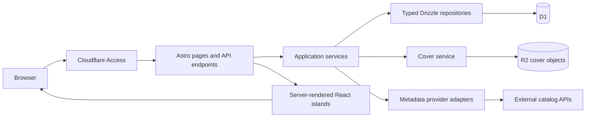

# Atelier Strawby — architecture

Status: Stage 5 local release QA is documented in [STAGE5.md](STAGE5.md). The current directory map is [DIRECTORY_STRUCTURE.md](DIRECTORY_STRUCTURE.md). Stages 1–4 are implemented and locally verified. Stage 3 retains the established schema, runtime and visual design; [STAGE3.md](STAGE3.md) records the implemented mutation, metadata, import/export and authentication boundaries. The remaining planning sections describe intended operating behavior and future release gates where not yet verified. Hosted readiness is unverified and existing dependency findings remain.

The authoritative requirements are [project_specification](../project_specification) plus the user's revised Stage 2–3 scope. The dataset is [initial_collection.csv](../initial_collection.csv). See [ROADMAP.md](ROADMAP.md), [DATA_MODEL.md](DATA_MODEL.md), [DECISIONS.md](DECISIONS.md) and [TESTING.md](TESTING.md).

Stage 3 uses shared Zod inputs, a small D1 Store interface with parameterized SQL, atomic batches and revision guards, and service modules under `src/server/`. Existing Drizzle schema/read services remain. Metadata and image failures do not control whether a collection copy can be saved. R2 persists eligible image bytes; D1 persists all collection data and provider/cache state. React forms refresh the existing shelf after mutations. No extra database or global state framework was introduced.

## Product and scope

Atelier Strawby is the project name; retain **Strawby Stacks — The Strawby Library** as the application title specified by the PRD. Keep these names in one configuration module so a later branding change is inexpensive.

Build one private, single-owner library for manga and CDs. Preserve personal notes, duplicate copies, edition titles, languages, and unknown dates. D1 is the production source of truth from the first implementation stage. Normalized seed JSON is an import artifact, never a second mutable database. Four explicitly labeled sample CDs demonstrate the CD experience; exclude them from personal statistics, timeline, and default CSV exports. Full JSON backups include samples to preserve the complete database.

## Runtime and technical choices

| Layer | Proposed choice | Reason |
| --- | --- | --- |
| Routing and rendering | Astro 5, TypeScript strict mode, on-demand rendering | Fresh collection reads after edits; useful initial HTML; no rebuild needed for mutations |
| Deployment | Cloudflare Pages, compatible `@astrojs/cloudflare` 12.x adapter | Matches the requested platform; lock tested patch versions |
| Interaction | React islands with the compatible Astro React integration | Shared shelf/filter/drawer state within one island per interactive page |
| Styling | Tailwind CSS 4 through its Vite integration; CSS tokens; Lucide icons | Small, consistent design system without a component framework |
| Persistence | Cloudflare D1; `drizzle-orm/d1`; reviewed SQL migrations generated with Drizzle Kit | Typed joins/inserts and inspectable migration history |
| Cover files | Private Cloudflare R2 bucket plus D1 asset metadata | Persistent object storage outside the deployment filesystem |
| Authentication | Cloudflare Access; server-side JWT verification | Single-owner access without building password storage or account management |
| Validation | Shared runtime schemas using one compatible Zod version | TypeScript does not validate CSV, HTTP bodies, or provider responses |
| Search | Dependency-free token/edit-distance matching in the shelf island | Typo-tolerant matching over the small collection and multilingual aliases |
| Verification | Astro/TypeScript checks, node:test, local Wrangler D1/R2, Playwright with axe | Domain rules, real database behavior, and user workflows |

Astro's current adapter documentation says newer adapters remove Pages support. Stay on Astro 5 with its Pages-compatible adapter, rather than installing all packages at `latest`. Confirm exact peer dependencies and a Pages build in Stage 1. A future Astro upgrade and Workers migration are a separate decision. [Current adapter migration notes](https://docs.astro.build/en/guides/integrations-guide/cloudflare/), [Astro 5 adapter documentation](https://v5.docs.astro.build/en/guides/integrations-guide/cloudflare/).

Use `output: 'server'`, with immutable assets served statically. Read D1/R2 bindings through the Astro 5 runtime adapter boundary; generate binding types with Wrangler. Keep Node-only CSV tooling in `scripts/`, outside runtime imports. Pages supports both D1 and R2 bindings. [Pages bindings](https://developers.cloudflare.com/pages/functions/bindings/).

Use the stable Drizzle release compatible with the selected runtime; do not adopt a release candidate merely because a current documentation example uses one. Drizzle supports the D1 driver, but database behavior and limits remain D1's. [Drizzle D1 integration](https://orm.drizzle.team/docs/sqlite/connect-cloudflare-d1).

## Request and data flow



Route handlers authenticate, validate, invoke services, and map typed results to HTTP. Services own import, matching, gap detection, and mutation rules. Repositories contain concrete queries; avoid generic repository frameworks. Provider adapters normalize external responses into explicit candidate types. UI modules import DTOs and validation schemas, never database bindings or provider secrets.

SSR pages call services directly rather than making HTTP requests to their own API. Hydration receives the same DTO snapshot used to render HTML. Serialize initial data safely; notes such as `<3` remain text, never HTML. Initial shelf data currently includes the complete authorized library, including copies and tracklists. There is no server pagination or lazy detail fetching; this is a documented scaling limitation.

## Proposed directory structure

The planning stage originally created only `docs/`. Stage 1 now implements the relevant subset of the structure below; later-stage UI/API/provider paths remain proposed. See the README for current runnable commands.

```text
atelier_strawby/
  project_specification                 # authoritative, unchanged
  initial_collection.csv                # immutable original input
  docs/
    ARCHITECTURE.md
    DATA_MODEL.md
    ROADMAP.md
    DECISIONS.md
    TESTING.md
  src/
    config/brand.ts
    layouts/AppLayout.astro
    pages/
      index.astro                       # shelf; URL-based media/filter/view state
      timeline.astro
      stats.astro
      import.astro
      series/[id].astro                 # direct-link and no-JS detail page
      albums/[id].astro
      add.astro
      edit/[id].astro
      api/
        collection.ts
        series/[id].ts
        albums/[id].ts
        items/index.ts
        items/[id].ts
        metadata/search.ts
        metadata/resolve.ts
        covers/refresh.ts
        imports/preview.ts
        imports/commit.ts
        imports/[id].ts
        exports/[format].ts
        timeline.ts
        stats.ts
      media/[id]/[variant].ts           # authenticated R2 image response
    components/
      shell/                            # header, desktop nav, mobile bottom nav
      ui/                               # buttons, fields, pills, badges, dialog, states
      covers/                           # book cover, jewel case, typography fallback
      shelf/                            # LibraryIsland, grids, spine rows, controls
      details/                          # series/album panels, volume cards, tracklist
      editor/                           # item forms, lookup chooser, date/tag fields
      imports/                          # mapping, preview, progress, error rows
      timeline/
      stats/
    domain/
      types.ts                          # discriminated media DTOs, IDs, dates
      schemas.ts                        # HTTP/import/provider validation boundaries
      normalization/                    # CSV rules, aliases, known corrections
      gaps.ts
      memory-tags.ts
      search.ts
    server/
      auth/                             # Access JWT and request-origin checks
      db/                               # client.ts, schema/, migrations adapter
      repositories/                     # concrete catalog/collection/import queries
      services/                         # collection, imports, exports, timeline, stats
      metadata/                         # adapters/, matching, cache, provider throttle
      covers/                           # source policy, validation, storage, selection
      http/                             # response envelope, error mapping, request IDs
    styles/tokens.css
    styles/global.css
    middleware.ts
    env.d.ts
  scripts/
    seed-from-csv.ts
    seed-sample-cds.ts
    cache-covers.ts
    verify-seed.ts
    restore-backup.ts
  data/
    sample-cds.json                      # deliberately marked demonstration records
    generated/                          # ignored seed/report artifacts, not public assets
  drizzle/                              # reviewed versioned SQL migrations
  public/
    fonts/
    favicon.svg
    _headers                            # static headers; dynamic headers set in middleware
  tests/
    fixtures/                           # CSV edge cases and recorded provider responses
    unit/
    integration/
    e2e/
  astro.config.mjs
  drizzle.config.ts
  wrangler.toml
  tsconfig.json
  package.json
  package-lock.json
  .dev.vars.example
  .gitignore
  README.md
```

Astro endpoints are the sole application router. Do not introduce a second `functions/api` tree alongside the adapter's generated Worker. Exclude all original CSV, private JSON, import reports, and exports from `public/` and deployment assets.

## API contracts and persistence

Use a discriminated union for manga/CD items and separate `SeriesSummary`, `SeriesDetail`, `AlbumSummary`, `AlbumDetail`, `MetadataCandidate`, `ImportPreview`, and `CollectionStats` DTOs. Persist dates as `YYYY-MM-DD | null` and serialize timestamps as ISO UTC. Map D1 rows explicitly; never cast an arbitrary response into an application type.

All JSON endpoints use `{ data, meta: { requestId, revision? } }` on success and `{ error: { code, message, fieldErrors?, retryAfter? }, meta: { requestId } }` on failure. Statuses include 400 invalid syntax, 401/403 access failure, 404 missing entity, 409 version/import conflict, 422 invalid fields, 429 throttling, and 503 unavailable dependency. A lookup timeout must not prevent manual saving.

| Interface | Responsibility |
| --- | --- |
| `GET /api/collection` | Authorized summary DTOs, facets, search entries, collection revision; media and sample scope |
| `GET /api/series/:id`, `/api/albums/:id` | Edition-aware detail including owned copies and per-copy notes |
| `POST /api/items`, `PATCH /api/items/:id` | Validated manga/CD creation and editing, with a version check |
| `GET /api/metadata/search`, `/api/metadata/resolve` | Bounded, authenticated candidates and exact provider record resolution |
| `POST /api/covers/refresh` | Fetch/cache one selected candidate or retry one failed asset; no arbitrary URL proxy |
| `POST /api/imports/preview` | Validate file, map columns, report inserts/conflicts/errors without changing ownership |
| `POST /api/imports/commit`, `GET /api/imports/:id` | Commit a preview tied to its hash/revision; resume/report bounded import chunks |
| `GET /api/exports/csv`, `/api/exports/json` | Authenticated downloadable backups with explicit schema version and sample scope |
| `GET /api/timeline`, `/api/stats` | Derived acquisition groups and aggregates; no hardcoded totals |
| `GET /media/:id/:variant` | Serve validated R2 bytes with dimensions, ETag, and private browser cache headers |

Later additions (2026-10-24): the implemented routes are `GET /api/library` (public; private notes and private haul stores removed) and `GET /api/library/owner` (owner-only, full notes). `POST /api/hauls` saves one atomic haul of up to 20 copies; see [DATA_MODEL.md](DATA_MODEL.md#logged-hauls). The offline shelf is a static service worker, `public/sw.js`.

Use Drizzle schema types for query safety and explicit runtime validation at boundaries. Generate SQL migrations, review their D1 compatibility, and apply through Wrangler. One tool owns migration execution. Use D1 `batch()` for bounded atomic writes; do not assume an interactive transaction callback is supported. D1 documents rollback of a failed batch. [D1 batch API](https://developers.cloudflare.com/d1/worker-api/d1-database/).

Bulk imports are staged, resumable, and hidden from collection queries until marked complete. Cap statements and bind parameters to the selected D1 plan; the published parameter limit is currently 100 per statement. Reconcile partial failures by import record identity. Ordinary item mutations are small atomic batches. [D1 limits](https://developers.cloudflare.com/d1/platform/limits/).

## Metadata lookup and cover caching

### Matching workflow

1. Search local aliases, accepted identifiers, and fresh cached metadata first.
2. Prefer exact ISBN for books and release MBID, barcode, or label/catalog number for CDs when supplied. These identifiers are absent from the initial CSV.
3. Otherwise search title plus author/artist; include alternate titles and requested language, volume, format, and country where supported. Normalize search keys without altering display text.
4. Present a small candidate list with provider, edition, language, date, and confidence explanation. Ambiguous or incompatible results require selection; automatic enrichment only accepts an unambiguous match with matching identifiers or edition evidence.
5. Keep owner edits and PRD corrections authoritative. Provider refresh fills unconfirmed missing fields; it does not replace acquisition notes/dates, confirmed metadata, or manually selected covers.
6. Record provider identifiers, source URLs, match basis, and retrieval time. Distinguish exact edition artwork from representative series/album artwork in detail views.

Provider adapters translate internal language codes explicitly (`EN` → `en`, `JP` → `ja`, `KR` → `ko`, or the provider's documented equivalents). Seed romanized titles are not proof of a Japanese-script alias; store native titles only when provided or confirmed. Keep individual provider query syntax and escaping inside its adapter.

### Provider roles and limitations

| Provider | Role | Boundaries and default policy |
| --- | --- | --- |
| MangaDex | Preferred series/title search and candidate volume cover lookup | Verify current endpoints, volume/locale fields, image policy, and headers in Stage 2. Official documentation could not be retrieved during planning; availability and quota are unverified. Do not fetch chapters or scan content. Missing or wrong-language covers remain unresolved. |
| Open Library | ISBN/edition metadata and alternative book cover source | Use identified, cached requests; start at 1 request/second. Respect its direct-image display guidance and avoid bulk cover crawling. Store source references rather than rehosting Open Library images by default. |
| AniList | Optional fallback for series aliases/metadata and representative series art | Its Media object has a series cover and total volume count, not an edition-specific cover catalog. Do not label its art as a confirmed volume cover or use its volume count for another edition's gap detection. |
| MusicBrainz | Album/artist search, exact release, release media, and tracklist | At most 1 request/second for the application, identifying User-Agent, shared throttling across requests; select a release rather than only a release group. |
| Cover Art Archive | Front artwork for a selected MusicBrainz release | Follow validated redirects; handle missing artwork and unavailable thumbnails. Release-group art is explicitly representative if the exact release has none. |
| iTunes | Optional alternative, disabled by default | Digital editions can differ from physical CDs. Apple's promotional artwork conditions require a suitable store-linked presentation; do not assume unrestricted rehosting. The primary CD path remains MusicBrainz + CAA. |
| Discogs | User-exported collection CSV input | Import the user's exported file with a mapping preview. Direct API synchronization and cover harvesting are outside the five-stage baseline. |

Provider facts are based on [Open Library API guidance](https://openlibrary.org/developers/api), [Open Library cover guidance](https://openlibrary.org/dev/docs/api/covers), [AniList Media schema](https://docs.anilist.co/reference/object/media), [MusicBrainz identification and rate limits](https://musicbrainz.org/doc/MusicBrainz_API/Rate_Limiting), [CAA API](https://musicbrainz.org/doc/Cover_Art_Archive/API), [Apple Search API conditions](https://developer.apple.com/library/archive/documentation/AudioVideo/Conceptual/iTuneSearchAPI/index.html), and [Discogs collection exports](https://support.discogs.com/hc/en-us/articles/360007331534-How-Does-The-Collection-Feature-Work).

### Cache layers and execution

- **D1 metadata cache:** provider, canonical request key, adapter schema version, sanitized response, retrieval/expiry times, and result status. Proposed TTLs: search results 24 hours, accepted stable metadata 30 days, no-result responses 24 hours, transient failures a short backoff. Provider-specific policy can shorten or forbid these defaults. Keep operational cache data separate from confirmed collection fields.
- **D1 provider throttle:** atomically acquire a provider lease and next-request slot shared by UI and utility requests. No isolate-local timer as the only limiter. If busy, return a retry interval instead of holding a request open. A shared Cloudflare egress IP can still encounter upstream throttling; honor that response.
- **R2 cover cache:** persist eligible image bytes under a content hash and variant key; retain source/provenance in D1. R2 is required for durable cached covers, not required to save a manually entered item. A provider whose policy requires direct delivery uses an external source mode instead.
- **Browser cache:** private, versioned image URLs with ETag. Never cache notes, exports, or authenticated HTML in a public shared cache. A future public artwork CDN is optional; an edge Cache API entry is not the durable source of a cover.
- **Automated utility (implemented in Stage 3):** `scripts/cache-covers.ts` (`npm run covers:cache`) calls `cacheMissingCovers` in `src/server/metadata/cover-utility.ts`. It enumerates missing eligible assets and uses the same provider adapters, D1 cache/leases and R2 cache service as interactive lookup. Series matches, applied artwork and provider responses are checkpointed in D1. It reports matched/cached/unmatched/failed/deferred/needs-selection outcomes. It resumes after interruption, does not run during deployment, uses only MangaDex for manga, and never guesses CD editions. It currently opens local Wrangler state only.
- **Interactive lookup:** debounce autocomplete about 300 ms, abort superseded searches, and ignore stale responses. Resolve metadata and cache the chosen cover in bounded requests. If artwork fails, retain the selected metadata and save the item with a fallback. Retry explicitly or via the resumable utility; no guarantee of unattended work after the browser/utility closes.

Use a configurable timeout (initially 8 seconds per external request), bounded redirects, and exponential backoff with jitter for 429/503 responses. The utility may wait between attempts; interactive handlers return promptly with retry information. Cache an authoritative no-result separately from a network failure. Never repeatedly search every volume on every shelf visit.

Accept only HTTPS provider-approved hosts, validate every redirect destination, reject credentials/private-network destinations and arbitrary user URLs, enforce byte limits (initially 8 MiB), and check image signatures as well as MIME type. Use JPEG/PNG/WebP; reject SVG and HTML from providers. Source metadata is untrusted text. Store original high-resolution art only when available and permitted; use supplied thumbnails for grid/detail sizes. Runtime serving must not require Node Sharp. Additional offline resizing is a later optimization if measurements justify it.

Cover selection is deterministic: manually chosen exact art, confirmed edition art, clearly identified representative art, then a typographic fallback using title, creator, volume, and stable palette. Never invent missing covers or a successful lookup. Reserve image dimensions to prevent layout shift; lazy-load below the first viewport and handle image decoding failures.

## Responsive component architecture

### Composition and state

| Component boundary | Responsibility |
| --- | --- |
| `AppLayout.astro` | Semantic landmarks, skip link, theme bootstrap, brand, fonts, header, desktop navigation |
| `LibraryIsland` | One SSR React tree for media switcher, search, filter pills, view mode, grid/spines, bottom navigation actions, and active detail panel |
| `ResponsiveDetailDialog` | Shared accessible dialog semantics; mobile bottom sheet and desktop side panel; one content tree across breakpoints |
| `SeriesDetail` | Authors, publishers aggregated from editions, owned languages, copy counts, edition tabs, ordered volume cards, gap toggle |
| `AlbumDetail` | Keyboard-operable jewel-case/obi interaction, artist credits, release/year, labels/catalog numbers, formats, discs/tracks, owned-copy notes |
| `ItemEditorIsland` | Manga/CD forms, lookup results, candidate confirmation, manual entry, per-field errors, save state and conflict recovery |
| `ImportIsland` | Generic CD CSV/Discogs mappings, preview, row issues, duplicate choices, commit progress, resumable errors |
| `TimelineIsland` | Date-grouped acquisitions, media filters, memory tags, unknown-date section |
| `Stats` | Server-derived statistic cards and accessible CSS/SVG charts; hydrate only interactive filters/tooltips |
| Shared UI primitives | Field, button, icon button, badge, segmented control, notice, skeleton, empty state, error state, image fallback |

Keep shelf state in its React reducer/context; separate page islands do not need a global store. Serialize media, filters, search, sort, view, and selected detail into the URL so refresh/back/share work. Theme and grid density can use local storage. On successful edits, update/reload affected DTOs and the search index using the returned collection revision. Avoid copying mutable collection state into several islands.

Use normal links for series/album cards with direct detail routes. Enhanced clicks open a dialog and update history; closing/back restores the shelf and focus. Direct navigation provides an accessible full detail page even before hydration. No-JS shelf filters submit URL parameters to server-side filtering. Add/edit routes provide a basic form submission path or an explicit usable fallback if an enhancement fails.

### Layout and visual system

- Preserve the PRD palette: paper `#FAF8F5`, dark espresso `#141413`, strawberry `#D9383A`, sage `#6B8E78`. Choose darker text variants where the decorative accent fails text contrast; sage is not automatically suitable for small white text.
- Use Geist for headings and the wordmark, Inter for body text, JetBrains Mono for metadata, and Newsreader italic for personal notes. Self-host licensed WOFF2 subsets, use `font-display: swap`, and provide serif/sans/monospace plus Japanese/Korean system fallbacks. Do not download an entire CJK font family for a few titles.
- Mobile: 2 columns by default, optional 3-column compact density when usable; horizontal filter pills; safe-area-aware bottom navigation with Shelf, Search & Filter, Haul Timeline, Stats, and Add. Bottom navigation must not cover the last row or dialog buttons.
- Desktop: centered shelf width, 5–7 cover columns as space permits, visible filter/sidebar controls, and a side dialog. Manga cards retain portrait art; CDs use square art with CSS jewel-case hinge/spine details.
- Spine view shows each owned manga/CD copy, including duplicates, in bounded horizontally scrollable shelf rows. Stable publisher/series colors supplement text. Every spine has an accessible title/number label and keyboard selection; a selected spine reveals a full-size control/card instead of relying on tiny touch targets.
- Dialogs use visible close controls, focus trapping, focus return, Escape, scroll locking, `aria-labelledby`, and touch-friendly buttons. Swiping is optional. Reduce animations for `prefers-reduced-motion`; disable 3D jewel-case motion in that mode.
- Target WCAG 2.2 AA: normal text 4.5:1, large text/UI boundaries as applicable 3:1, 44 px preferred touch targets, keyboard-only completion, and information conveyed with text as well as color. Charts include an equivalent data table.

### Search, filters, gaps, and analytics semantics

Index title, native/romanized aliases, edition title, author/artist, publisher/label, and resolved notes. Preserve JP/KR characters; Unicode normalization and accent-insensitive matching are search-only transformations. Match title fields more strongly than notes. Filter **within a dimension with OR**, **across dimensions with AND**, and combine with search. Apply language/publisher/note constraints to the same owned item before grouping it into a series, avoiding a false match assembled from different editions. Show both matched and total owned counts.

Deterministic note rules derive `Gifts from Sammy`, `Kinokuniya Trips`, `Box Sets`, `Korea Trip`, and `Proxy Hauls`. Keep original notes and allow manual tags. Do not infer a Sammy gift from a generic Christmas note. Edition tags are separate from memory tags. Details of numbering and gaps are in [DATA_MODEL.md](DATA_MODEL.md).

Initial case-insensitive rules match `from sammy`, `kinokuniya`, `box set`, `korea trip`, and `proxy`, respectively, in expanded notes. A `box set` match adds both the Box Sets memory category and the Box Set edition tag; `omnibus` notes and explicit Collector's Edition titles add their edition tags. Rules annotate the record without rewriting its note or guessing a specific omnibus component range.

Timeline groups by each item's acquisition date, not the import date or note batch. Unknown dates have their own section. Default newest-first with an oldest-first option. Stats count actual owned manga records, distinct owned parent series, publisher and author contributions, and dated acquisitions by year; show unknown-date count separately. Sample CDs never inflate personal totals. An album package counts as one owned CD item; its disc count is a separate value.

### Required UI states

| Area | Loading | Empty | Error / fallback |
| --- | --- | --- | --- |
| Shelf/search | Reserved cover skeletons; existing results while refreshing | First-item prompt; filtered-empty state with clear-filters action | Retry notice; initial server HTML remains usable when hydration fails |
| Detail | Panel skeleton with close button still active | No owned volumes, no tracklist, unknown fields labeled | Retry detail; missing entity route; safe text cover |
| Metadata | Searching indicator, cancel superseded query | Manual entry and alternative title prompt | Rate-limit countdown/retry; manual save stays available |
| Editor/import | Disabled duplicate submission; progress/status announcement | Clear import template and mapping instructions | Preserve input; field errors; conflict review; failed rows downloadable |
| Timeline/stats | Stable card/list placeholders | Honest zero-data state | Retry; unknown dates and incomplete data explicitly counted |
| Cover | Fixed aspect ratio | Typographic book/CD face | Same fallback on 404, timeout, corrupt image, or blocked provider |

## Access, operations, and deployment

All collection, search-index, metadata, import/export, and mutation endpoints require the single owner's Access identity in hosted environments. Validate JWT signature, issuer, audience, and expiry in middleware, rather than trusting an email header. Protect the custom domain, `pages.dev`, and preview URLs; a direct origin request must fail closed. Local development may use an explicit local-only identity flag, never an enabled hosted default. [Cloudflare JWT validation](https://developers.cloudflare.com/cloudflare-one/access-controls/applications/http-apps/authorization-cookie/validating-json/).

Require same-origin checks and a CSRF token for browser mutations; use protected service credentials for the cover/import utility. Check version numbers for concurrent edits and idempotency keys for retried creations/import commits. Do not log personal notes, tokens, or uploaded file contents. Log request ID, outcome, duration, provider status, and import issue counts.

Use separate local, preview, and production D1 databases/R2 buckets. Pin a tested compatibility date and dependencies. Build/test migrations in local Wrangler, then an isolated preview. Production release requires correct bindings, identity configuration, a fresh export/restore check, and a clean-browser persistence test. Do not run migrations automatically on every request or re-seed on every deployment.

Versioned JSON is the lossless application backup, including ownership IDs, bibliographic entities, relationships, provenance, and cover references. CSV is a spreadsheet-friendly ownership export; JSON/SQL preserve relational details. Offer an authenticated restore utility, D1 SQL exports, and R2 asset backup/inventory instructions. Provider cache responses and credentials are excluded from portable backups. D1 recovery windows vary by plan, so Time Travel supplements portable exports rather than replacing them. [D1 limits and recovery windows](https://developers.cloudflare.com/d1/platform/limits/).
