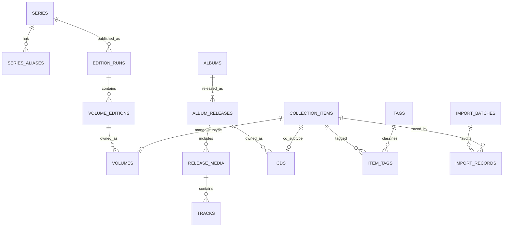

# Normalized relational design

Status: implemented in [the Drizzle schema](../src/server/db/schema/index.ts) and [the initial SQL migration](../drizzle/0000_foundation.sql). The migration and seed pass actual SQLite and local workerd D1 tests; Drizzle Kit parity and baseline snapshot history are verified. This design implements the ownership and ingestion requirements in [project_specification](../project_specification). See [Stage 1 results](STAGE1_VALIDATION.md).

## Core distinctions

**Series → edition run → volume edition → owned volume.** A series can have English, Japanese, and Korean runs with different titles, publishers, formats, and numbering. Multiple owned copies may reference one volume edition. Two similar records must never be collapsed merely because their series and number match.

**Album → release → media/discs → tracks; release → owned CD.** Album grouping is independent of a particular country, label, catalog number, or CD+Blu-ray edition. A multi-disc package is one owned item with multiple media rows. Artists and author credits can be plural.

Shared `collection_items` holds acquisition dates, personal notes and edit versions. `volumes` and `cds` are one-to-one subtypes. This gives the requested Series/Volumes/CDs concepts while avoiding duplicated timeline and tagging logic.

The diagram omits credit, publisher/label, and infrastructure joins for readability; all are specified below.

## Conventions

- SQLite tables use `snake_case`, TypeScript uses `camelCase`. IDs are stable text UUIDs, not titles. Seed IDs derive deterministically from a seed namespace and source identity; manually created IDs use random UUIDs.
- `PK` means primary key, `FK` means enforced foreign key, `UQ` means unique constraint, and `?` means nullable. Ordinary entity rows carry UTC `created_at`/`updated_at` timestamps where useful.
- Calendar acquisition dates are ISO `YYYY-MM-DD` text or null. They do not undergo UTC conversion. Release dates may be `YYYY`, `YYYY-MM`, or `YYYY-MM-DD`, with a checked precision field; do not turn an unknown month/day into January 1.
- Enumerations are TypeScript literal unions and SQL `CHECK` constraints. Validate actual calendar dates at the application boundary. Booleans are integers constrained to 0/1.
- Search keys are derived normalized values; retain original display Unicode. Use JSON only for external cache payloads and audit snapshots, not for domain lists of volumes, tracks, authors, tags, or languages.
- No `owner_id`/tenant framework is needed for one private library. A future multi-library product requires a deliberate scoped migration and authorization design.

## Catalog tables

| Table | Principal columns and constraints |
| --- | --- |
| `creators` | `id PK`, `display_name`, `search_key`, `kind` (`person`, `group`, `collective`, `unknown`). Names alone are not globally unique identities. |
| `publishers` | `id PK`, `name`, `normalized_name UQ`. Preserve names such as `Udon Entertainment`; a chip may use a display abbreviation. |
| `labels` | `id PK`, `name`, `normalized_name UQ`. Labels and manga publishers have separate roles. |
| `series` | `id PK`, `canonical_title`, `sort_title`, `description?`, `representative_cover_id FK?`. Do not store derived owned count or a single language/publisher here. |
| `series_aliases` | `id PK`, `series_id FK`, `title`, `search_key`, `locale?`, `kind` (`native`, `romanized`, `edition`, `legacy`). `UQ(series_id, search_key, kind)`; an alias is not globally unique. |
| `series_creators` | `series_id FK`, `creator_id FK`, `role`, `credit_order`; composite PK on series/creator/role. Preserve the supplied credit without inventing contributors. |
| `edition_runs` | `id PK`, `series_id FK`, `edition_title`, `language CHECK EN/JP/KR`, `language_basis` (`specified`, `assumed`, `confirmed`), `publisher_id FK?`, `format` (`standard`, `omnibus`, `collectors`, `artbook`, `anthology`, `unknown`), `numbering_basis` (`printed`, `source_record`, `unknown`), `numbering_verified` boolean, `medium` (`manga`, `light_novel`, `book`; added by `0001_edition_medium`, default `manga`). A run owns one coherent numbering/language/format/medium convention. Books reuse the volume subtype (`media_kind = 'manga'` means a printed volume); the UI presents `book` runs as a separate Books category, and light novels stay with manga. |
| `volume_editions` | `id PK`, `edition_run_id FK`, `volume_label`, `volume_sort INTEGER?`, `book_title` (added by `0003_book_titles`, default empty; independent of the series number), `numbering_key`, `isbn13?`, `cover_asset_id FK?`, `metadata_state` (`unverified`, `partial`, `confirmed`). `volume_sort` uses thousandths to support 0.5 without float comparisons. `UQ(edition_run_id, numbering_key)` identifies a bibliographic volume within a run; distinct printings/numbering systems use separate runs. Partial unique index on non-null normalized ISBN where the catalog mapping is confirmed. |
| `albums` | `id PK`, `title`, `sort_title`, `description?`. One album/release-group concept, not a physical copy. |
| `album_creators` | `album_id FK`, `creator_id FK`, `role`, `credit_order`, `credited_as?`, `join_phrase?`; composite PK on album/creator/role. Preserve collaboration display order. |
| `album_releases` | `id PK`, `album_id FK`, `edition_title?`, `release_date?`, `date_precision?`, `country_code?`, `edition_description?`, `barcode?`, `cover_asset_id FK?`, `metadata_state`. Barcode is indexed but not assumed universally unique; it is stored as a 13-digit GTIN (UPC-A with a leading zero) and set by CD barcode scanning or the editor. |
| `release_labels` | `id PK`, `release_id FK`, `label_id FK`, `catalog_number?`, `credit_order`; duplicate non-null label/catalog tuples within a release disallowed. Catalog numbers are text, retain punctuation/leading zeros, and are not globally unique. |
| `release_media` | `id PK`, `release_id FK`, `position INTEGER > 0`, `format` (`CD`, `Blu-ray`, `DVD`, `other`), `title?`; `UQ(release_id, position)`. The displayed package format derives from these rows and edition description. |
| `tracks` | `id PK`, `medium_id FK`, `position INTEGER > 0`, `printed_number?`, `title`, `duration_ms INTEGER? CHECK >= 0`, `recording_mbid?`; `UQ(medium_id, position)`. Unknown duration remains null. |

Index every FK used in joins and filters. Additional indexes: series/album sort title, alias search key, edition runs `(series_id, language, publisher_id)`, volume editions `(edition_run_id, volume_sort)`, and release labels `(label_id, catalog_number)`. Add more only from measured queries.

## Owned items and tags

| Table | Principal columns and constraints |
| --- | --- |
| `collection_items` | `id PK`, `media_kind CHECK manga/cd`, `acquired_on?`, `notes?`, `notes_private` boolean default 1 (added by `0003_private_notes`; a private note and its derived memory tags are withheld from the public shelf), `acquisition_batch_id FK?` → `acquisition_batches` (added by `0004_acquisition_batches`), `is_sample` boolean default 0 (retired: sample CDs were removed by `0005_remove_sample_cds`; always 0 and unused by the app), `date_unknown` boolean default 0 (added by `0006_cleanup_queue`), `version INTEGER >= 1`, `import_batch_id FK?`, `idempotency_key UQ?`, timestamps; `UQ(id, media_kind)` supports typed subtype FKs. |
| `volumes` | `item_id PK`, `media_kind` fixed to `manga`, `volume_edition_id FK`; composite FK `(item_id, media_kind)` → collection items. **No unique constraint on volume edition**: several owned records can reference it. |
| `cds` | `item_id PK`, `media_kind` fixed to `cd`, `release_id FK`; composite FK `(item_id, media_kind)` → collection items. **No unique constraint on release**. |
| `tags` | `id PK`, `slug UQ`, `label`, `category` (`memory`, `edition`). Examples: Gifts from Sammy / memory; Box Set / edition. |
| `item_tags` | `item_id FK`, `tag_id FK`, `source` (`derived`, `manual`), `rule_version?`; composite PK on item/tag/source. Recompute derived tags on note edits without removing manual tags. |

Every committed collection item must have exactly one matching subtype. The fixed-kind composite FK prevents a mismatched or double subtype; create the parent and subtype in a single batch, and check for missing subtypes in integration tests and import finalization. SQL foreign keys alone do not guarantee the parent has a child.

Owned count is `COUNT(collection_items)` within the selected media/import scope. Unique owned volume numbers are a separate derived metric. Ownership pages always exclude items whose import batch is not `complete`. Date indexes support timeline and stats. Tag joins must not multiply aggregate counts.

Default delete policy restricts deletion of referenced catalog rows; joins/media/tracks can cascade when their parent is deliberately removed. Do not automatically delete catalog metadata or R2 files when an item is edited. Destructive library management is not required by this PRD.

## Metadata, files, and import audit

| Table | Principal columns and constraints |
| --- | --- |
| `external_refs` | `id PK`, `provider`, `provider_entity_type`, `external_id`, `source_url`, `fetched_at`, `match_basis`, `is_owner_confirmed`; nullable FKs to `series`, `volume_editions`, `albums`, `album_releases`, or `creators`, with a `CHECK` requiring exactly one target. `UQ(provider, provider_entity_type, external_id)`. Use real FKs rather than an unconstrained generic target ID. |
| `cover_assets` | `id PK`, `provider`, `source_url?`, `source_record_id?`, `storage_mode` (`r2`, `external`), `status` (`pending`, `ready`, `missing`, `failed`), `match_scope` (`edition`, `representative`), `source_language?`, `fetched_at?`, `retry_after?`, `last_error_code?`, `policy_version`, `attribution?`, `is_owner_selected` boolean. |
| `cover_variants` | `id PK`, `cover_asset_id FK`, `variant` (`grid`, `detail`, `original`), `object_key?`, `external_url?`, `sha256?`, `mime_type`, `width?`, `height?`, `byte_size?`, `etag?`; `UQ(cover_asset_id, variant)`. Exactly one delivery location is set; dimensions/size are positive when present. |
| `metadata_cache` | `cache_key PK`, `provider`, `adapter_version`, `payload_json?`, `status`, `fetched_at`, `expires_at`, `retry_after?`. Bounded size; response JSON is validated before use. It is disposable infrastructure, not authoritative catalog data. |
| `provider_state` | `provider PK`, `lease_token?`, `lease_expires_at?`, `next_allowed_at`, `blocked_until?`. Compare-and-set acquisition coordinates provider limits across instances; expired leases can be reclaimed. |
| `import_batches` | `id PK`, `source_kind`, `source_filename`, `source_sha256`, `mapping_version`, `status` (`preview`, `committing`, `complete`, `failed`), `preview_revision?`, `error_summary?`, timestamps; `UQ(source_kind, source_sha256, mapping_version)`. |
| `import_records` | `id PK`, `batch_id FK`, `source_record_number INTEGER > 0`, `item_id FK?`, `source_row_json`, `normalization_audit_json`, `status`, `issue_codes_json`; `UQ(batch_id, source_record_number)`. Preserve only relevant source fields, not discarded spreadsheet legend cells. |
| `collection_state` | Singleton key and monotonic `revision`; changes when a committed owner mutation or import changes collection data. Used for stale editor/import detection and index invalidation. |

Keep asset bytes out of D1. R2 and D1 cannot commit in one transaction: upload to an immutable key first, then reference it in D1; preserve previous references on failure. An interrupted upload may leave an unreferenced object, which a conservative maintenance inventory can report. Never mark an asset ready before its bytes exist.

The operational tables support required caching and deterministic imports. They are not a general job scheduler, user system, or event-sourcing framework.

## Logged hauls

`acquisition_batches` (`0004_acquisition_batches`) has `id PK` (a client-chosen UUID, so later parts of a large haul join it), `acquired_on?` (same calendar CHECK as copies), `store?`, `store_private` boolean default 1, and `created_at`. A haul save (`POST /api/hauls`, `src/server/services/hauls.ts`) creates or updates the haul row and plans every copy in one atomic D1 batch. Each copy also stores the haul's date and note in its own `acquired_on`, `notes` and `notes_private`, so the timeline, stats, search and note privacy work unchanged. Editing a copy keeps its haul unless the owner unchecks it. Deleting a copy leaves the haul row, which is harmless and kept in backups. A save holds at most 20 copies. A full 20-copy save measured 305 D1 queries (123 reads, 182 writes) for a new series and 225 for an existing one, under the 1,000-per-request paid limit. The server also refuses more than 650 planned writes. This is distinct from CSV `import_batches`. JSON backups made before 0004 restore without the table, and their copies have no haul.

## Data clean-up queue

`0006_cleanup_queue` adds three owner-review flags, each `INTEGER NOT NULL DEFAULT 0` with a `(0,1)` CHECK, added with `ADD COLUMN` (no table rebuild): `collection_items.date_unknown` (the owner confirmed the acquisition date is unknown), and `volume_editions.cover_unavailable` and `album_releases.cover_unavailable` (no cover exists). Recording a date in the editor clears `date_unknown`; saving a cover clears `cover_unavailable`. The flags are sent only in the owner's library view. JSON backups made before 0006 restore with every flag at 0.

The queue itself (`src/domain/cleanup.ts`) is computed from the owner's library, with the same scope as the stats caveats. Language and numbering cards are per edition run, so one answer covers every copy in it. `POST /api/cleanup` (`src/server/services/cleanup.ts`) applies one answer atomically under the collection revision guard, and checks that what the owner saw is still current (the edition's recorded attributes, or the copy's version):

- **Edition:** updates `edition_runs` in place, so copy, volume and run identities stay the same. An editor save would instead have filed the corrected copies under a separate run. If the corrected run is identical to another owned run, the two merge: volume editions move across, and a volume present in both keeps the surviving volume edition, gaining any ISBN or cover only the other one had.
- **Date:** sets one copy, or a whole logged haul and its copies, since a haul shares one date. "I don't know" sets `date_unknown`.
- **Cover:** confirming a representative cover creates an owner-selected, edition-scope copy of the asset (reusing cached R2 bytes) for that volume edition only, because a representative asset can be shared. Its identity is the one an editor re-save computes. Removing clears the reference. A chosen candidate (`POST /api/cleanup/covers`, which reuses the cover utility's MangaDex and Open Library matching but also offers near matches) is saved as edition scope. CD covers are never guessed.

Every change bumps the version of each affected copy, so an open editor form gets a 409.

## Barcode scans and request limits

Scanning writes no new catalog tables. `volume_editions.isbn13` holds the scanned, checksum-valid ISBN for the volume edition (shared by its copies). `metadata_state` is left unchanged, so the confirmed-ISBN unique index is not engaged. `external_refs` records the owner-confirmed catalog record (`provider_entity_type='edition'`, `match_basis='isbn'`, `is_owner_confirmed=1`).

Migration `0002_request_limits.sql` adds `request_limits(bucket PK, window_start, count)`: operational fixed-window counters, excluded from backups. See [SCANNING.md](SCANNING.md).

## Deterministic CSV ingestion contract

The implemented entry point is `scripts/seed-from-csv.ts`. The default source is the actual `initial_collection.csv`; `--input` supports the long filename mentioned in the PRD. The source remains unchanged. Parsing uses a tested RFC-compatible CSV state machine, not splitting on lines or commas.

1. Read and validate the six domain headers: Title, Volume, Author, Publisher, Date Acquired, Notes. Select these explicitly. The real file has two empty headers instead of `Unnamed: 6` and `Unnamed: 8`; both and `Language Legend` must be ignored. Trim each domain field and retain its original value in the audit record.
2. Preserve input order while expanding notes. A nonempty real note becomes `activeBatchNote`. `|` copies it. A backslash/slash terminator copies it and clears it. Accept the specification spelling and the real CSV's two-backslash spelling of the marker; do not broadly strip punctuation from ordinary notes.
3. A blank note becomes null and clears the active note, interpreting the PRD's cascade as contiguous rows. An orphan `|` becomes null plus a warning. An orphan terminator may copy the immediately previous resolved note only if both dates are present and equal; otherwise null. Compare validated calendar dates. A date change does **not** break an explicitly marked active cascade.
4. Apply declarative corrections by title/volume and expected source values, not by absolute row number. Report applied/skipped/conflicting corrections. Merge `Girls Last Tour` into `Girls' Last Tour`; normalize `Yoshitoki Oima` to `Yoshitoki Ōima`; fix SPY x FAMILY 3 to Tatsuya Endo; fix Fruits Basket: Illustrations 1 to Natsuki Takaya/Yen Press; fill Saka Mikami/Kodansha for Fragrant Flower 1–3; fill inee/Kadokawa for LOVE BULLET 1. Never overwrite a different owner-confirmed correction on re-import.
5. Map alternate titles to parent series while preserving the original edition title. Apply KR to A Sign of Affection (KR); JP to Yubisaki to Renren, Kaoru Hana wa Rin to Saku, K-ON! from Houbunsha, and Project SEKAI from DNA Media. K-ON! from Yen Press is explicitly EN. Other entries default to EN with `language_basis='assumed'`; the CSV does not contain per-row language values, and this is not verified language evidence.
6. Parse M/D/YYYY and MM/DD/YYYY into validated calendar dates. Empty date → null. Nonempty invalid date → blocking row issue, not today's date. Parse the supplied integer volume labels, preserving the raw label and numerical sort value.
7. Derive memory/edition tags from normalized notes/titles using a versioned rule table. Preserve notes verbatim after trimming/cascade expansion. Box Set is a per-copy edition tag; Collector's Edition can describe an edition run; an `omnibus` note alone does not prove a particular collected-volume range.
8. Generate deterministic normalized records, an audit report, and parameterized import statements. Every input ownership row gets a distinct stable ID, even if it shares bibliographic data. Stable sort outputs; exclude wall-clock timestamps from deterministic data digests.
9. Validate counts, required fields, references, aliases, correction outcomes, and duplicates before persistence. Apply to local D1, verify, then allow an explicitly targeted hosted seed later. Do not fetch network metadata during normalization.
10. A repeat of the identical source is a no-op for owned records and never overwrites later edits. A changed source file or mapping version produces a preview of reconciliation choices; it must not silently double the library. Cross-file duplicate candidates remain reviewable, because identical bibliographic details can represent legitimate copies.

Initial source row numbers in audit output are **1-based data-record numbers, excluding the header**. The PRD's cited numbers generally correspond to zero-based records. Match semantic identity so this discrepancy cannot misapply a correction.

## Concrete grouping and gap behavior

| Example | Intended representation |
| --- | --- |
| A Sign of Affection / KR / Yubisaki | One series, three edition runs, 10 owned records overall; retain each edition title and language |
| Fragrant Flower / Kaoru Hana | One series, EN and JP runs; four owned records |
| K-ON! | One series; four JP Houbunsha records and four EN Yen Press records |
| The Guy She Was Interested in… Vol 1 | Two owned records (data rows 158 and 173). They may provisionally share a volume edition; do not invent a different edition or merge the owned copies. |
| Fruits Basket: Illustrations | Separate work from Fruits Basket: Collector's Edition; do not collapse an artbook into a narrative series based on a shared franchise |
| Steins;Gate rows labeled 1–3 with `omnibus` | Retain all three source ownership records. Flag uncertain packaging/numbering instead of guessing whether they describe one physical omnibus. |

Gap detection operates per edition run and deduplicates its owned numbers before computing gaps. Default to internal holes between minimum and maximum owned integer labels; show contiguous runs and allow an explicit “from volume 1” mode. Owning 1–3 and 7 yields 4–6. The actual CSV also owns 86 volume 4, so its internal holes are **5–6**, not the illustrative PRD example's 4–6. Never infer missing future releases from the largest owned number.

Do not combine EN/JP/KR numbering, collector's numbering, or omnibus component counts. For unknown/source-record numbering or nonnumeric labels, show an explanation and owned runs rather than false gaps until the owner confirms the convention. Numeric collector's volumes can use their own printed numbering. Artwork, duplicate copies, and sample data do not alter gap calculations.

For ordinary integer rows, treat the CSV Volume field as provisional printed numbering; this is sufficient to calculate observed internal holes, including the actual 86 example. `numbering_verified` separately records physical/provider confirmation. Explicitly ambiguous omnibus records use `numbering_basis='source_record'` and do not produce claimed physical-edition gaps until reviewed. This keeps a useful gap detector without presenting uncertain packaging as verified.

## Baseline established by the planning audit

Source SHA-256: `8e7b935ee024654b715c4e88ac406013105961ef3282aec7e0f88ebb35004a0a`.

| Measure | Expected result under the documented rules |
| --- | --- |
| Parsed manga ownership records | 177 |
| Distinct trimmed input titles | 42 |
| Canonical series after specified merges | 38 |
| Language assignments | 167 EN, 9 JP, 1 KR; 163 of the EN assignments are assumptions |
| Acquisition dates | 172 known, 5 unknown; 55 distinct known dates |
| Acquisition years | 2021: 21; 2022: 96; 2023: 26; 2024: 29; unknown: 5 |
| Note markers | 57 continuation markers; 17 terminators |
| Resolved nonempty notes | 97 |
| Repeated series/volume/language/publisher candidate | One pair, preserved as two owned copies |
| Corrected publisher totals | Kodansha 76; VIZ Media 42; Yen Press 33; Udon Entertainment 9; Houbunsha 4; Kadokawa 4; DNA Media 3; Seven Seas 2; Kaiten Books 2; Mag Garden 1; Square Enix 1 |

These are independently computed planning expectations, not a completed TypeScript ingestion test or externally verified bibliography. The required 177 count measures imported ownership records; the possible omnibus packaging ambiguity remains documented.
